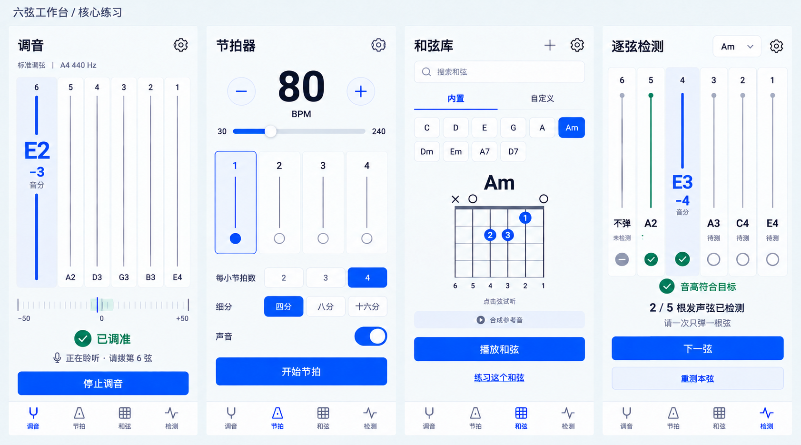
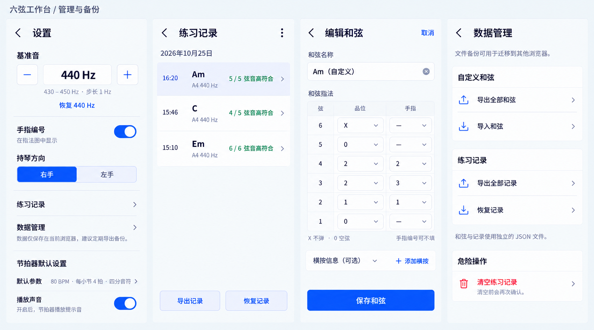
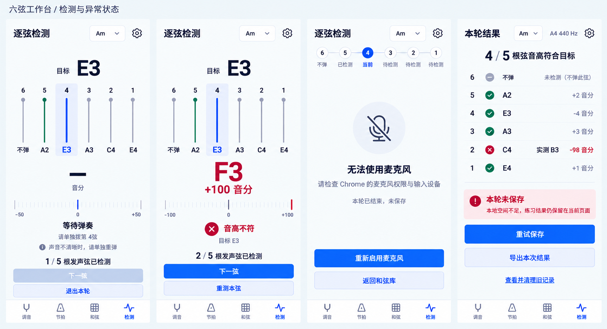

# 六弦工作台 · 已选方向 A

用户于2026-10-25选定 oil-ui 方向A。北极星：拿着吉他时，一眼看清当前音高，单手完成下一步。

本轮交付为静态移动端设计稿与设计说明，不是可交互原型、HTML页面或Figma源文件；未编写应用代码。保持用户明确说“开始执行”前不实现的约束。

## 最终图稿

### 核心练习

四屏依次为调音、节拍器、和弦库、逐弦检测。另有[独立调音首屏](tuner.png)便于查看六轨布局。

### 管理与备份

四屏依次为设置、练习记录、和弦编辑、数据管理。基准音明确提供1Hz加减，指法表与Am指法图一致；备份遵循和弦、记录分开的已确认规则。

### 检测与异常状态

四屏依次为等待弹奏、音高不符、麦克风不可用、本轮保存失败。有效错音可继续；无有效单音时不可推进；保存失败仍可重试或导出本次结果。

每个子画面目标逻辑视口390×844。交付图为高分辨率栅格设计板，不按输出图片像素直接推断CSS尺寸、触控面积或真实字体。

## 为什么选择六弦结构

- 用户已选A，不继续发散B、C。
- 六条轨道直接承担选弦和位置参照；选中弦突出，其他弦保持安静。它不表示能够识别声音实际来自哪根弦。
- 节拍器用四条拍轨延续语法，避免为保持形式而强行使用六拍。
- 指法图仍按标准六弦结构绘制，不为风格牺牲可读性。
- 首屏只有一行任务标题；不再重复“Guitar Learn字标＋页面标题”，将空间留给读数和操作。

## 最小视觉规范

| 角色 | 目标值 |
| --- | --- |
| 页面底色 | #F1F4F8 |
| 主文字 | #182138 |
| 次要文字 | #55627A |
| 主操作／选中 | #254DFF |
| 选中浅底 | #E4EAFF |
| 轻分隔 | #C7D1EC |
| 符合目标 | #17694D，同时配勾号与文字 |
| 不符／删除 | #B52E3D，同时配文字与图标 |
| 中文字体意向 | Noto Sans SC，400／600 |
| 音名与数字字体意向 | IBM Plex Mono，500／600 |
| 文字目标 | 标题24px，正文16px，辅助14px；窄轨中只保留简短名称 |
| 触控目标 | 不小于44×44px，主按钮高52px；尚待实际页面验证 |
| 形状 | 8px圆角，轻描边，无厚重拟物旋钮或多层卡片 |

图稿中的生图字体不等于已嵌入上述字体，色值是制作目标而非图片采样结果。六轨布局预算为选中轨104px、其他轨各44px、轨间4px，总宽344px；实现时按实际字体和视口重新核验，不照搬图中像素。

## 关键状态与动作

- 调音器：选目标弦后启动；±5音分内显示已调准。此图为第6弦E2偏低3音分，符合已调准范围，不表示全部六弦都调准。
- 逐弦检测：Am目标音按第5→1弦为A2、E3、A3、C4、E4。第6弦不弹，仅显示未检测。当前弦由步骤指定，匹配八度并在±20音分内才符合。
- 等待：不残留旧的实测音高，不判错，下一弦不可用；细刻度的零点只作基准轴，不代表已有读数。
- 有效错音：F3相对E3为+100音分，可重测或手动下一弦；示例刻度扩展至±100，指针在右端。
- 完成但未保存：结果仍在当前页面，明确区分检测完成与存储成功；可重试、导出或清理旧记录。
- 设置：基准430–450Hz、步长1Hz；默认440Hz。检测进行中锁定基准，结束后才能修改，未另行更改需求。

## 动效交接说明（仅设计，未实现）

手感参照“咔嗒——拨动开关到位”，不模拟真实琴弦物理。

1. 主操作：按下约80ms即时反馈，视觉缩至0.98后在150ms内回位；点击区域尺寸不变，业务状态不等待动画。
2. 选弦／下一弦：选中底板及强调线在约180ms内移到目标弦，读数和状态直接按有效检测更新；不对实时音高数字做翻滚，避免干扰辨音。
3. 首次进入：六条轨线与标签按阅读顺序轻微淡入，总长约300ms，只在第一次进入播放；不加开屏广告、伪检测进度或自动声音。

音高符合时的小勾号可约120ms出现，但不延迟结果。减少动态效果开启时，所有状态直接到位。以上未录屏验证，也不构成已满足1秒响应的证据。

## 评审与减法

完成1轮独立静态视觉评审，初版核心7/10、管理8/10、异常7/10，初版总分7/10。根据反馈修正了指法手指标签、错音刻度和部分滑杆位置，明确1Hz输入，删减设置外框、窄轨重复状态文字及异常页重复进度栏。主Agent直接看图复核，未对修正版重新打分。

保留六弦轨道辨识度，同时不引入宣传语、课程入口、分数卡或额外解释来填空。仍有两点视觉精度需要后续实现时核验：80BPM滑杆位置是近似绘制，正式映射必须为(80−30)/(240−30)=23.81%；轨道高度与主动作距离还可在实际触屏页面里压缩。详见[评审记录](REVIEW.md)。

## 参考与取舍

已直接查看[Soundbrenner官方产品画面](https://www.soundbrenner.com/pages/the-metronome-app)和[Fender官方商店截图](https://is1-ssl.mzstatic.com/image/thumb/PurpleSource211/v4/58/c0/22/58c02261-8df0-7b01-938e-9b760a3d9fbb/143486f8-ce62-4aee-ae3b-279f6babe791_Fender_FenderPlay_US_iOS_5.5_SS_Revisions_02.png/392x696bb.png)。借鉴具体选弦、音高优先及独立拍点的关系；不复制Fender的拨片标识和圆形主视觉，也不沿用Soundbrenner的拟物凸起、青绿色身份及曲目列表。

## 交付边界

使用oil-ui的方向卡、北极星、标杆看图、视觉减法和独立评审流程。因当前任务为设计稿且用户未授权代码，页面与动效未实现；界面由内置image_gen表达，未采用oil-ui通常建议的真实HTML/CSS排版方式，不能声称字体、响应式、触控、键盘或读屏通过验证。

桌面布局、导入逐条校验面板、备份冲突提示、删除确认及完整列表详情没有逐一展开为独立图稿，按MVP已确认规则继续深化；不将这套主页面和关键状态稿称为全部边界都已视觉验收。未运行音频、文件读写、生产构建或业务测试。

完整[生成与修正提示词](PROMPTS.md)已保存。旧三套候选稿仍在上级目录，不覆盖。正式设计文件均在本目录；过程参考与初稿仅留在项目的本地工作区。

