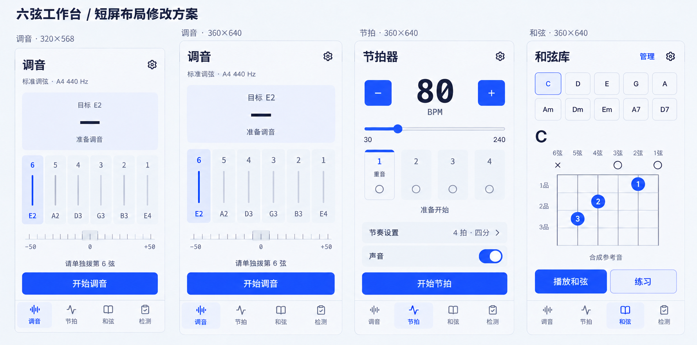

# 六弦工作台 · 短屏修改方案

日期：2026-10-26。状态：基于检查报告提出的设计方案，尚未实施，不改变已确认业务规则。沿用方向 A、冷灰白／钴蓝及六弦轨道语言。

## 依据与北极星

依据为项目中当天的[滚动与首屏操作报告](../../../../.scratch/ui-scroll-audit/2026-10-26/report.txt)、测量及真实截图。已实际看过调音、节拍、和弦、检测待开始的截图，并核对对应布局代码。本方案不把旧报告当成新版本验证。

北极星：拿着吉他时，当前读数和下一步始终在一起。

## 修改后布局稿

设计板展示320×568、360×640调音，以及360×640节拍、和弦的目标结构。它是内置image_gen生成的静态布局示意，视口标注为设计目标；生成图各子画面的比例与几何并非精确浏览器输出，不能据此宣布溢出、触控面积或首屏高度已通过。完整提示词见PROMPT.md。

## 一、统一页面壳：主操作获得空间，不遮盖内容

页面从上到下分为三层：

1. **练习工作区**：紧凑标题、当前对象、读数／图示、必要反馈；按当前可见高度分配。
2. **主操作区**：在底部导航上方单独占一行；常规高约64–72px，按钮目标高52px。工作区必须预留对应空间，不能用浮层遮住内容。
3. **模块导航**：调音、节拍、和弦、检测，按当前导航视觉保留，目标约64–72px，另计真实安全区。

这不是把原按钮简单改成fixed。操作与导航作为同一底部区域分配高度，主体使用剩余空间；低频设置、记录详情、编辑和导入详情允许自然滚动。可见区域被工具栏、键盘、安全区或文字放大压缩时，重新分配而非假定固定844px高度。

**减法优先顺序**：先移除重复说明和管理动作，再减少轨道／仪表高度与非必要空白，最后允许主体滚动；不压缩44px触控目标，不把正文缩成小字，不裁掉当前状态和对象名称。

## 二、调音：六弦等宽，共享读数

### 已确认问题

320px视口内可用宽296px，而当前列最小宽之和为76＋5×44＋5×4＝316px；横向溢出20px。轨道固定300px，导致360×640的主要操作落到导航以下。

### 具体改法

- 短屏采用等宽六列，不为选中列额外加宽。320px视口两侧各12px时，可用296px，扣除五个4px间距后，每列46px，仍保留44px触控底线。
- **实测读数移到轨道上方的共享区域**，显示目标音、实际音高和音分；不把大字硬塞进46px窄列。未收音显示“—”，不伪造已调准。
- 六轨只放弦号、短弦线与目标音名。高度随剩余区域收缩，短屏初始建议约88–140px，长屏可放大，但不统一锁300px。
- 音分刻度、必要状态紧接轨道，开始／取消／停止／重试留在同一个主操作区。
- 删除重复“准备调音”与重复目标信息；保留标准调弦、当前基准和必要权限／偏差提示。隐私、能力说明可放设置中的说明入口，不占每次练习的主区域。

### 状态边界

麦克风请求中仍可取消；无有效单音不留旧音高。权限错误可替换当前仪表区为原因和重试指引，而不是在仪表后不断追加内容、把按钮继续推低。偏差与有效检测门槛不变。

## 三、节拍：读数、拍点、启停同屏

- 速度输入、加减按钮与滑块保持首屏，减少滑块端点的独立大行距。
- 四条拍轨保留，但高度不再靠固定仪表尺寸决定；短屏示意约96–120px，先保证拍点及当前拍可读。
- “每小节拍数”和“细分”收进**节奏设置**入口，入口本身显示“4拍 · 四分”等当前值，避免隐藏配置结果。
- 展开的节奏设置可使用可滚动的底部面板，完整保留2／3／4拍及四分／八分／十六分选项；不是删除设置。
- 声音开关可见，开始／停止／继续留在主操作区。保留“下一小节应用”和麦克风占用／声音待恢复提示，不以布局优化改变音频互斥与手动恢复规则。
- 第一拍重音用固定顶线和“重音”标识表达；当前拍使用仅在运行时出现的拍点反馈，停止时四个拍点为空心。开始变为停止、暂停后变为继续，按钮不换位置；错误提示占工作区，不挤走启停操作。
- 去掉“跟上每一拍”和重复合成音解释；停止时显示准备开始，运行时显示实际拍点，不用装饰性循环冒充节拍。

## 四、和弦：练习主区与管理入口分开

- 首屏顺序改为：选和弦 → 当前名称 → 指法图 → 播放／练习。
- 新增、复制、编辑、删除与文件入口进入**管理**次级区域。当前选中和弦与滚动位置需保留，从管理返回后不丢上下文。
- C指法所需仅三格，不为它固定画五格；一般按当前指法所需品格及起始品标注绘制，高把位／横按不能省略。跨度大的自定义指法可以展开查看，不将“三格”硬编码成所有和弦的限制。
- 保留指法图中的逐弦试听。播放和弦为主按钮，“练习”是次按钮，可在主操作区同排；不放两个同等高饱和主按钮。
- 编辑、导入校验和长列表允许自然滚动；这不影响练习时指法与播放动作同屏的目标。

## 五、逐弦检测：待开始通过不等于所有状态通过

现有待开始状态不强行重排。其余状态采用同样的内容与操作分区复核：

| 状态 | 工作区主角 | 操作区 |
| --- | --- | --- |
| 等待有效单音 | 当前弦、目标音与等待提示；不显示旧结果 | 下一弦不可用，可退出 |
| 有效符合／错音 | 当前目标、实际音、偏差及结果；避免重复进度 | 下一弦主动作，重测次动作 |
| 麦克风不可用 | 原因及本轮状态 | 重试／返回，不自动恢复声音 |
| 完成未保存 | 结果摘要与“本轮未保存”，结果列表可滚动 | 重试保存主动作，导出次动作 |

不能为固定底栏挡住错误原因、关闭错误提示后仍不可恢复，或以切换页面清掉未保存结果。

## 六、设备与特殊条件

| 条件 | 布局约束 |
| --- | --- |
| 320×568 | 六列等宽，轨道优先收缩；最低目标是无横向滚动、当前读数与主动作可见 |
| 360×640 | 对应报告的主复验视口；调音、节拍、和弦需同时看到必要内容与主动作 |
| 390×844 | 保留同一信息顺序，增加轨道留白；不反向恢复无条件固定高度 |
| 横屏约640×360 | 工作区可用左右两区：读数／状态与紧凑轨道／指法；共用底部操作和导航，不把竖屏300px轨道直接搬来 |
| 浏览器工具栏变化 | 按当前可见区域分配，不能按物理屏幕高度推算底部位置 |
| 安全区 | 导航内计入真实底部安全边距；操作区和内容不能重复或漏算 |
| 键盘弹起 | 优先保证当前输入与提交动作可达；底部导航可让位，不能覆盖BPM、名称、品位输入 |
| 文字放大至200% | 允许重排和必要滚动，不保证所有内容仍同屏；保留阅读顺序、文本完整和按钮可达，不缩字号硬塞 |

尺寸为方案起点，而非当前代码已达到的值。最小触控面积、文字换行、宽度和浏览器行为必须用实际页面测量。

## 七、动效与验收交接

- 主操作按下立即反馈，不等动画完成才开始／停止；操作区位置不随状态切换跳动。
- 选弦仍使用同一选中底板和强调线，短屏不以列宽变化造成整体挤动。
- 节奏设置从触发入口展开，关闭返回同一位置；减少动态效果时直接到位。
- 本轮只写动效规则，未实现或录屏验证。

后续实际验收需分别记录：文档与六弦容器scrollWidth不超clientWidth；六根弦都能直接点击且触控不小于44px；主操作完整位于导航上方、不遮读数或指法；展开设置、打开键盘、显示长错误后仍能恢复；保存失败内容不丢失。覆盖表中四档视口、等待／有效结果／错误／保存失败，以及工具栏、安全区、文字放大条件。

## 范围

未改应用代码、未替换旧设计稿、未重新跑浏览器或音频验收。本方案的页面画面仅为设计说明，不能替代报告所要求的真实复测。完成1轮独立静态方案复核，不打分；已补充运行／异常状态约束并修正重音与当前拍的表达，详见[复核记录](REVIEW.md)。

