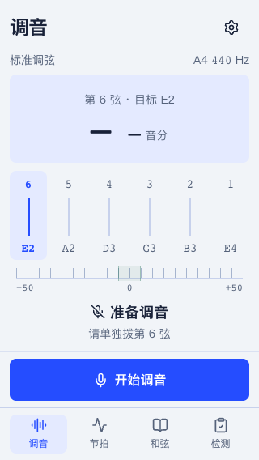
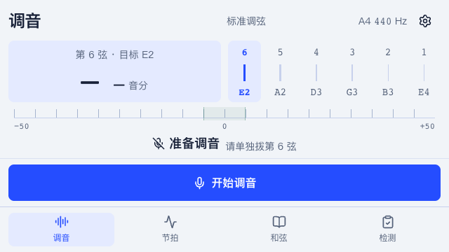
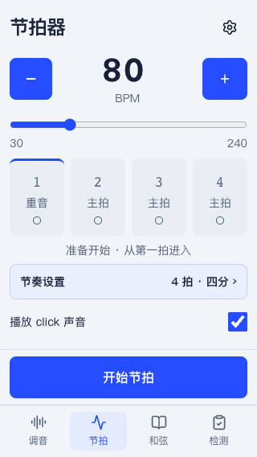
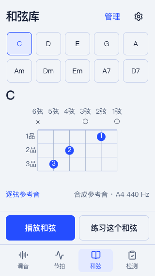
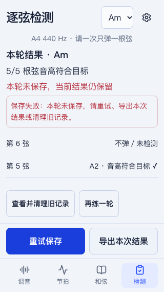

# 短屏布局实施与验证

日期：2026-10-26。按[设计方案](../design/2026-10-26/short-screen-layout/README.md)实施。本记录仅证明本轮软件与布局检查，真实琴音和设备验收仍按[原验收表](ticket-01-audio.md)执行。

## 实施结果

- 页面分为可滚动工作区、独立占位的主操作区、导航；主操作不再随长内容被推到导航下方，也不以浮层遮挡内容。
- 调音六弦等宽，目标、实际音高和音分共用读数区；权限等待、取消、停止和错误重试使用同一操作位置。
- 节拍保留BPM、拍点和声音开关；拍号与细分进入可滚动原生对话框，关闭恢复触发按钮焦点。停止时拍点为空心，重音顶线与当前拍分开表达。
- 和弦练习与管理分开；指法只画必要品格，大跨度仍可展开，高把位、横按、镜像及逐弦试听保留；播放与练习同排。
- 检测中的等待、符合／错音、权限错误、完成未保存采用相同操作分区；保存失败原因置于结果列表前，列表独立滚动，重试／导出可达。
- 低频隐私说明移入设置。额外修正独立体验中发现的参考音播放结束后提示不更新，使用真实音源结束事件更新状态。

没有改动指定检测库、音准阈值、节拍调度、本地文件协议和存储保护规则。

## 定向验证

| 检查 | 结果与边界 |
| --- | --- |
| 四档布局 | 320×568、360×640、390×844、640×360；无页面或六弦横溢；六弦触控宽高至少44px；读数／指法与主操作完整位于导航上方 |
| 短屏流程 | 节奏设置保存与焦点返回、和弦管理返回保留选中目标 |
| 可见视口缩高代理 | 模拟visualViewport由568缩至300，编辑BPM时导航让位，读数和动作可达，恢复后导航返回；不是原生手机键盘测试 |
| 200%逻辑重排代理 | 160×284 CSS视口、deviceScaleFactor=2，无横溢，各按钮通过滚动可完整进入视口；不是OS字体放大实测 |
| 异常状态 | 权限请求取消／拒绝、等待不允许推进、有效错音允许推进、重测、完成保存失败保留结果与重试／导出；2项用例各重复3次，6/6通过 |
| 参考音状态 | 连续再次播放与自然结束提示，用例重复3次通过 |
| 原有流程回归 | tuner/practice按名选择6项，覆盖权限拒绝／迟到输入释放／断麦、检测基准锁定与页面切换、保存失败救回、从和弦进入新目标；6/6通过 |

新增布局回归共8项。初始测试遇到Vite依赖预打包504，重启本项目5174服务并重建依赖缓存后恢复；不把环境故障记为有效的失败先行证据。逻辑重排最初被浏览器“已在视口”的整数可见性判断干扰，后改为明确居中滚动并保留严格几何断言，没有放宽溢出阈值。

本轮运行类型检查、lint和相关浏览器文件／用例分组；未执行全量测试或生产构建。当前本机预览地址为 http://localhost:5174/ （5173由其他项目占用）。

## 独立复核

独立体验Agent `short_screen_ux` 使用360×640真实页面，从C指法、播放参考音、进入对应检测页、返回展开逐弦试听走查；未启用真实麦克风，不声称完成检测全流程。发现播放结束提示滞留，已修复并由自动化结束事件回归覆盖。

静态视觉复核及最终定向文件结果见下方收尾记录。

## 截图

以下为真实浏览器输出，非设计稿：

## 待实机补齐

原生手机键盘、动态工具栏、刘海／底部安全区、OS文字放大与触屏体验仍需真实设备确认。真实吉他／麦克风精度、库的已知合成诊断偏差和实际节拍发声时序门槛保持未通过状态，不能由本轮布局代理或合成输入代替。

## 收尾结果

- 独立静态视觉Agent `short_screen_visual_review` 实际检查方案和18张截图，不打分。发现640×360调音的状态提示被截断；已将横屏标题与基准信息同排，补充整个反馈区必须完整位于操作区上方的断言，四档用例4/4复验通过。独立评审者随后查看更新后的横屏截图，确认原问题消除、状态和按钮同屏无遮挡。其余截图未见需返工的明显问题。静态评审不证明动效或完整音频流程。
- 最终相关文件合并执行22/22通过（chords 9、metronome 5、short-screen 8）；其后上述横屏修正复验4项通过。异常状态6次及参考音自然结束3次重复通过，另有原流程定向6项通过。
- 最终类型检查、lint、差异空白检查通过；没有运行全量测试或生产构建。临时浏览器视口恢复。
